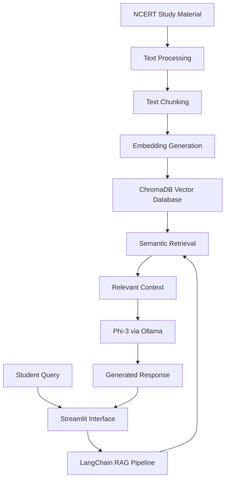

# NCERT RAG AI Tutor

An AI-powered conversational tutor designed to help Class 10 CBSE students understand NCERT Science concepts through Retrieval-Augmented Generation (RAG), semantic search, and locally hosted Large Language Models.

## Overview

NCERT RAG AI Tutor is an educational chatbot that retrieves relevant information from NCERT study material and uses a locally running language model to generate contextual explanations.

The project combines document processing, vector embeddings, semantic retrieval, and conversational AI to create an interactive learning experience.

## Features

- **Retrieval-Augmented Generation:** Generates answers using relevant NCERT study material.
- **Semantic Search:** Retrieves relevant text chunks using vector embeddings.
- **Conversational Interface:** Supports follow-up questions and contextual conversations.
- **Local LLM Integration:** Uses Ollama to run Phi-3 locally.
- **Vector Database:** Uses ChromaDB to store and retrieve document embeddings.
- **Text Chunking:** Splits study material into manageable chunks for efficient retrieval.
- **Interactive UI:** Provides a chatbot interface using Streamlit.
- **Local Processing:** Runs inference locally without requiring a paid LLM API.

## Technology Stack

| Component | Technology |
|---|---|
| Programming Language | Python |
| Frontend | Streamlit |
| LLM Framework | LangChain |
| Language Model | Phi-3 |
| Model Runtime | Ollama |
| Embedding Model | nomic-embed-text |
| Vector Database | ChromaDB |
| Retrieval Architecture | RAG |

## System Architecture



## Project Structure

```text
ncert-rag-ai-tutor/
│
├── streamlit_app.py       # Streamlit chatbot interface
├── rag_pipeline.py        # RAG pipeline and conversational chain
├── chunking.py            # Text chunking functionality
├── data_ingestion.py      # Document ingestion and processing
├── ncert_text.txt         # NCERT source text
├── Modelfile              # Custom Ollama model configuration
├── requirements.txt       # Python dependencies
├── README.md              # Project documentation
└── .gitignore             # Git ignored files
```

The ChromaDB vector database is generated locally and is not included in the repository.

## Getting Started

### Prerequisites

- Python 3.11 or later
- Ollama
- Git

### 1. Clone the repository

```bash
git clone https://github.com/deva2905/ncert-rag-ai-tutor.git
cd ncert-rag-ai-tutor
```

### 2. Create a virtual environment

```bash
python3 -m venv venv
source venv/bin/activate
```

### 3. Install dependencies

```bash
pip install -r requirements.txt
```

### 4. Install and start Ollama

Download Ollama from:

https://ollama.com/

Start the Ollama service.

### 5. Download the required models

```bash
ollama pull nomic-embed-text
ollama pull phi3:latest
```

### 6. Create the custom model

```bash
ollama create phi3-fast -f Modelfile
```

### 7. Generate the vector database

Run the following Python commands from the project directory:

```bash
python
```

Then execute:

```python
from chunking import create_chunks_from_text
from langchain_community.embeddings import OllamaEmbeddings
from langchain_community.vectorstores import Chroma

chunks = create_chunks_from_text("ncert_text.txt")

embedding_model = OllamaEmbeddings(
    model="nomic-embed-text"
)

vectorstore = Chroma.from_texts(
    texts=chunks,
    embedding=embedding_model,
    persist_directory="./ncert_db_local"
)

print("Stored documents:", vectorstore._collection.count())
```

Exit Python:

```python
exit()
```

### 8. Run the application

```bash
streamlit run streamlit_app.py
```

The application will open in your browser.

## Example Questions

- Explain the concept of reflex action.
- What is the difference between hormones and nervous control?
- Explain the human nervous system in simple terms.
- Give me a step-by-step explanation of a concept.

## Current Scope

The current implementation focuses on NCERT-based conversational question answering using a locally hosted language model.

Future improvements could include:

- Support for additional NCERT subjects and chapters.
- Personalized learning paths.
- Topic-wise quizzes and assessments.
- Student progress tracking.
- Improved conversational memory.
- A broader collection of NCERT learning resources.

## Acknowledgements

This project builds upon collaborative work from the original [NCERT RAG Bot repository](https://github.com/haris-collab/ncert-rag-bot). Credit and attribution to the original contributors are retained.

## License

No license has currently been specified. Please check the original project's licensing and obtain the necessary permissions before redistributing collaborative code or NCERT-derived materials.
